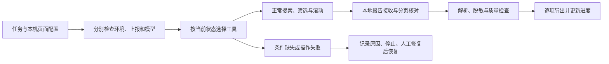

# 工作流、提示与 skill

本项目的主线是公开团购数据采集。模型调用受限工具，本地代码执行界面观察、搜索、滚动、输入解析、质量检查和导出。默认不处理个人订单或支付记录。

## 从任务到结果

工作台分别保留当前进程内的环境、上报和 API 检查记录，不再用最后一条结果代表所有连接。保存新任务会重置环境与上报检查记录；修改网页 API 设置后提示重新测试。记录在服务重启后清空，避免把历史检查当作当前连接保证。检查状态不绕过采集质量门禁。

当前截图由本地 OCR 处理，点击来自当前窗口的唯一文字匹配。采集模型只收到任务引用、阶段和受控摘要，没有直接接收截图。因此准确描述是 **LLM 工具编排 + GUI 自动化 + OCR + 本地数据处理**；不是已经实现截图驱动的自主多模态规划。

## 可审阅的运行提示

运行时提示位于 [`groupbuy/prompts/collection.md`](../groupbuy/prompts/collection.md)，随安装包分发，版本为 `collection-v1`。它明确每个阶段对应的工具、何时恢复滚动、何时停止，以及完成必须来自本地校验。报告保存提示版本，便于排查行为变化。

`AgentSettings.max_idle_rounds` 默认 4。连续只读检查或被拒调用且任务状态没有变化时，返回 `agent_no_progress`，不继续消耗全部 48 轮。成功执行的界面/解析工具会重置计数，避免把同一阶段内的有效续滚误判为空转。这是本地检查，不依赖模型自称“没有进展”。

## 可分发的采集 skill

[`skills/groupbuy-collection/SKILL.md`](../skills/groupbuy-collection/SKILL.md) 指导编码助手协助配置、诊断、运行与交接。支持 skill 的工具可按自己的方式安装该目录；其他同学直接按文档使用 CLI 或网页即可。skill 不代替模型服务，也不是运行依赖。

## 已阅读借鉴的仓库

| 来源 | 本项目采用的组织思路 |
|---|---|
| [cloudcollection/aoi-atlas](https://github.com/cloudcollection/aoi-atlas) | 首页先讲用途、第一次运行与最终输出，将高级机制留在文档 |
| [cloudcollection/dianping-store-collector](https://github.com/cloudcollection/dianping-store-collector) | 小批次起步、清楚说明结果位置、暂停恢复与现场限制 |
| [cloudcollection/unesco-boundary-workflow](https://github.com/cloudcollection/unesco-boundary-workflow) | 无网络合成演示、命令→结果表、可分发的工作流说明 |
| [browser-use 的系统提示](https://github.com/browser-use/browser-use/blob/main/browser_use/agent/system_prompts/system_prompt.md) | 以当前状态和动作反馈选择下一步；不宣称继承浏览器 DOM 能力 |
| [Anthropic skill-creator](https://github.com/anthropics/skills/blob/main/skills/skill-creator/SKILL.md) | 指令、执行代码与参考资料分离，使用具体任务验证 skill |
| [OSWorld evaluators](https://github.com/xlang-ai/OSWorld/tree/main/desktop_env/evaluators) | 动作执行与独立结果判断分开；本项目没有接入 OSWorld |

提示与 skill 独立编写，没有复制第三方实现，也没有借此宣称新的多模态模型或论文性能。软件测试、连接探测和真实采集成功分别报告。
